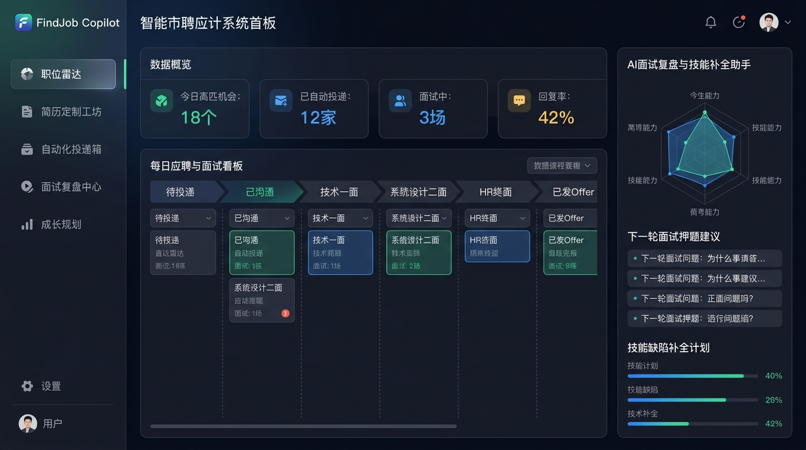
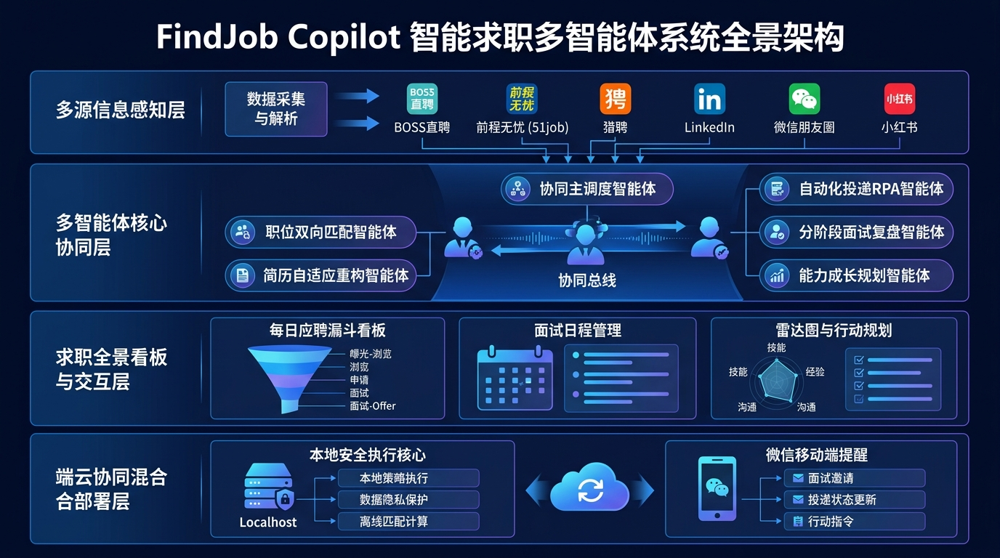
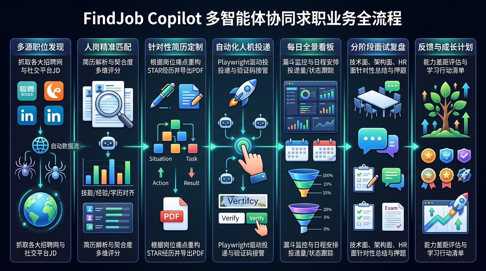

# FindJob Copilot - 智能求职多智能体副驾驶系统

<p align="center">
  
</p>

<p align="center">
  <a href="LICENSE"></a>
  <a href="https://www.python.org/downloads/"></a>
  <a href="https://fastapi.tiangolo.com/"></a>
  <a href="https://playwright.dev/"></a>
  <a href="https://github.com/features/actions"></a>
  <a href="SECURITY.md"></a>
</p>

<p align="center">
  <b>[ 简体中文 ]</b> | <a href="README_EN.md">English</a>
</p>

---

## 🌟 项目简介 (Overview)

**FindJob Copilot** 是一款面向个人求职者（ToC）的**开源、全自主、隐私优先**的多智能体协同求职副驾驶系统。

在当前的求职环境中，求职者面临海量非结构化招聘信息繁杂、一简历通投回复率低、招聘平台风控严格、面试复盘无体系及技能提升方向模糊等诸多痛点。FindJob Copilot 构建了一整套从**全网多源机会嗅探、人岗双向智能匹配、千岗千面自适应简历重构、本地安全人机协同投递、求职全景大屏，到分阶段面试深度复盘与能力闭环跃迁**的完整闭环体系。

> **🔒 隐私与安全承诺**：本项目遵循 **Local-First（本地优先）** 原则。所有岗位数据、个人简历、平台会话凭据与操作审计流水完全落盘在您本地设备（SQLite 数据库），**不上传任何外部中心化服务器，绝不泄露任何敏感信息**。

---

## 🏛️ 系统架构与业务全景 (Architecture)

系统采用 **端云协同混合架构（Localhost 安全执行核心 + 移动端轻量通知）**，并由六大专业智能体与主调度中枢协同运转：

<p align="center">
  
</p>

### 业务时序与全生命周期闭环
<p align="center">
  
</p>

### 六大专业子智能体编排
1. 🔍 **`JobCollectorAgent`（职位多源感知嗅探官）**：全网探测 BOSS直聘、猎聘、前程无忧、脉脉、微信朋友圈、小红书口语化内推帖，利用大模型结构化抽取真实在招信息。
2. 🎯 **`MatchEngineAgent`（人岗双向精准匹配官）**：深度双向语义加权推理，输出 0-100 分综合评分卡，自动提炼核心匹配亮点与技能短板。
3. 📝 **`ResumeTailorAgent`（针对性自适应简历重构工匠）**：基于真实经历与 **STAR 原则**，针对目标 JD 核心痛点定向重构项目经历，生成直击 HR 痛点的定制问候语。
4. 🤖 **`AutoApplierAgent`（自动化投递与人机协同接管官）**：复用本地已登录 Chrome 会话执行自动化上传投递；遇到平台滑块验证码或二次认证时触发桌面接管通知，完成验证后无缝恢复。
5. 🎤 **`InterviewReviewAgent`（分阶段面试深度诊断导师）**：针对技术一面、架构二面、HR终面现场问答进行底层考点剖析、答辩漏洞排查，并精准押题预测下一轮高频必考题。
6. 📈 **`GrowthPlannerAgent`（技能跃迁与行动规划官）**：归因面试反馈，动态更新个人技能五维雷达图，输出包含源码研读与实操任务的成长闭环清单。

---

## 📂 项目工程目录全景 (Project Structure)

```text
FindJob-Copilot/
├── .github/                                 # GitHub Actions CI 工作流与模板
│   ├── workflows/ci.yml                     # 跨版本自动化持续集成
│   ├── ISSUE_TEMPLATE/                      # Bug 反馈与特性需求模板
│   └── PULL_REQUEST_TEMPLATE.md             # PR 提交模板
├── .gitignore                               # 严密的安全拦截规则（排除 .env、数据库与私有凭据）
├── .env.example                             # 环境变量与 API Key 配置脱敏模板
├── LICENSE                                  # Apache License 2.0 开源许可证
├── README.md                                # 中文项目主页
├── README_EN.md                             # 英文国际化项目主页
├── CONTRIBUTING.md                          # 开源贡献指南
├── CODE_OF_CONDUCT.md                       # 社区行为规范
├── SECURITY.md                              # 安全与隐私防护政策
├── requirements.txt                         # Python 项目依赖清单
│
├── data/                                    # 本地持久化数据存储目录（默认被 gitignore 隔离）
│   └── job_copilot.db                       # 本地 SQLite 数据库
│
├── docs/                                    # 详细架构与实施设计方案
│   ├── SYSTEM_DESIGN.md                     # 详细架构设计白皮书
│   ├── ADR-001-deployment-and-agent-architecture.md  # 架构决策记录
│   └── images/                              # 中文架构与流程图高清图集
│       ├── job_copilot_architecture.jpg     # 系统全景架构设计图
│       ├── job_copilot_agent_flow.jpg       # 多智能体协同求职全流程图
│       └── job_copilot_ui_dashboard.jpg     # 全景看板 UI 原型图
│
├── src/                                     # 核心源码包
│   ├── __init__.py
│   ├── main.py                              # 命令行端到端闭环自测流水线
│   ├── server.py                            # 本地 FastAPI Web 控制台与 RESTful API 入口
│   ├── db/                                  # 本地持久化与审计引擎 (database.py)
│   ├── services/                            # 业务调度服务层 (job_service.py)
│   ├── models/                              # 领域数据实体模型 (job.py)
│   ├── agents/                              # 六大子智能体实现 (collector, match, tailor...)
│   ├── core/                                # 编排中枢 (orchestrator.py, llm_client.py)
│   └── static/                              # 暗黑科技风响应式求职 WebUI 看板 (index.html)
│
└── tests/                                   # 自动化测试套件
    └── test_audit_and_api.py                # 端到端 API 与操作审计测试
```

---

## ⚡ 快速开始 (Quick Start)

### 1. 环境准备
确保您的运行环境中已安装 **Python 3.10+** 及 **Git**。

```bash
# 克隆仓库
git clone https://github.com/xunavy/Job-Copilot.git
cd Job-Copilot

# 创建并激活虚拟环境
python -m venv .venv
# Windows:
.venv\Scripts\activate
# Linux/macOS:
source .venv/bin/activate

# 安装项目依赖
pip install -r requirements.txt
```

### 2. 配置环境变量 (可选)
复制配置模板文件：
```bash
cp .env.example .env
```
在 `.env` 中按需配置您的大模型 API 密钥（系统支持 DeepSeek、OpenAI、智谱 GLM、月之暗面 Kimi 或本地私有 Ollama 模型）：
```bash
LLM_PROVIDER=deepseek
LLM_API_KEY=sk-your-api-key-here
LLM_API_BASE=https://api.deepseek.com/v1
LLM_MODEL=deepseek-chat
```
> **💡 免 Key 体验**：若未配置 API Key，系统内建了完善的资深专家级逻辑降级兜底机制，所有流程和 WebUI 功能均可 100% 顺畅体验！

### 3. 运行自动化测试
```bash
python -m unittest tests/test_audit_and_api.py
```

### 4. 启动本地 Web 控制台与全景看板
```bash
python -m src.server
```
服务启动后，在浏览器中打开：👉 **http://127.0.0.1:8000**

---

## 🛡️ 系统级不可篡改操作审计 (Audit Trail)

系统将全流程的关键写操作（抓取、人岗加权评估、简历自适应重构、投递提交、滑块接管、阶段流转、面试复盘等）自动织入不可篡改的系统审计流水表 `audit_logs`。
- **实时审计跑马灯**：前端顶部动态滚动最新自动化操作状态；
- **全要素可追溯**：控制台专属【📜 全流程审计日志】中心支持按事件动作（`AUTO_APPLY`, `MATCH_EVALUATION`, `TAILOR_RESUME`, `UPDATE_STAGE`）溯源详情与历史上下文。

---

## 🤝 开源贡献与社区 (Contributing)

我们热忱欢迎社区贡献！
- 提交 Bug 或功能建议前，请参阅 [CONTRIBUTING.md](CONTRIBUTING.md)；
- 请遵守我们的社区行为准则 [CODE_OF_CONDUCT.md](CODE_OF_CONDUCT.md)；
- 涉及安全与隐私保护的漏洞，请遵循 [SECURITY.md](SECURITY.md)。

---

## 📄 开源许可证 (License)

本项目基于 [MIT License](LICENSE) 协议开源。
您可以自由使用、修改及商业分发，但请保留原作者版权声明与许可证说明。
