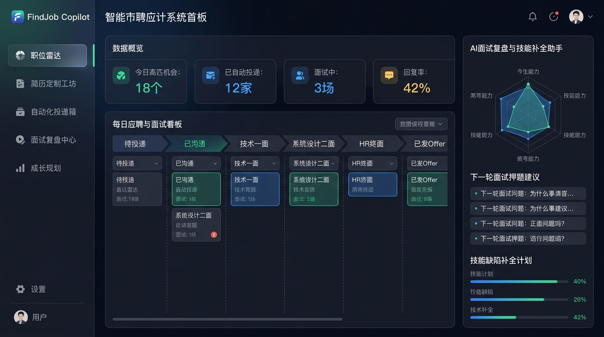
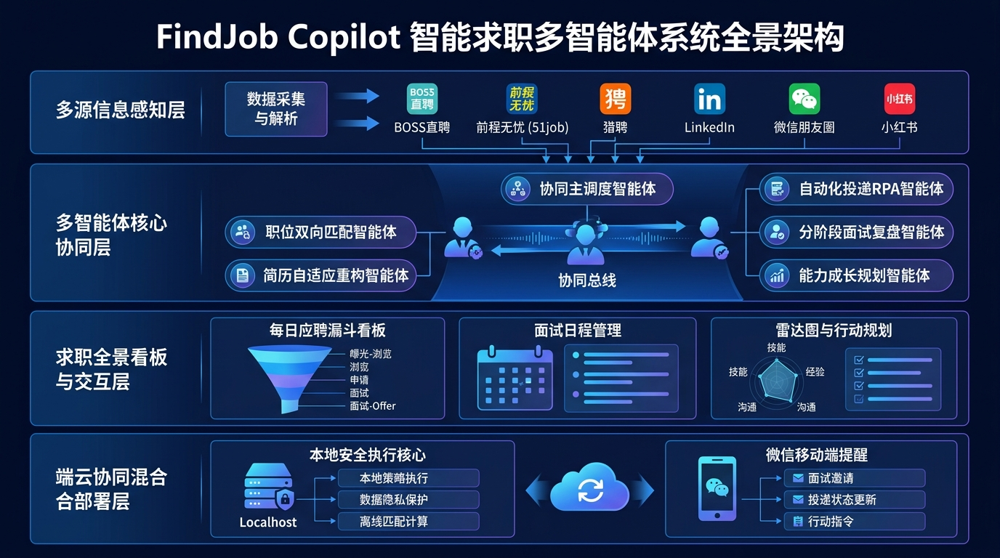
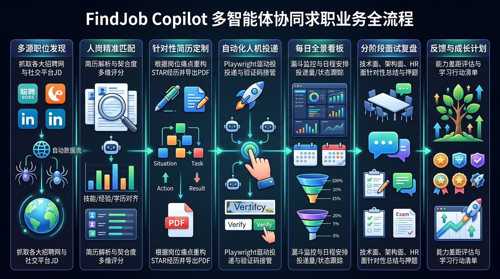

# FindJob Copilot - Agentic Job Search Assistant

<p align="center">
  
</p>

<p align="center">
  <a href="LICENSE"></a>
  <a href="https://www.python.org/downloads/"></a>
  <a href="https://fastapi.tiangolo.com/"></a>
  <a href="https://playwright.dev/"></a>
  <a href="https://github.com/features/actions"></a>
  <a href="SECURITY.md"></a>
</p>

<p align="center">
  <a href="README.md">简体中文</a> | <b>[ English ]</b>
</p>

---

## 🌟 Overview

**FindJob Copilot** is an open-source, fully autonomous, privacy-first multi-agent job search co-pilot system engineered for individual job seekers (ToC).

Job seekers often struggle with scattered opportunities across various platforms, low resume response rates, strict platform anti-scraping policies, unstructured interview reviews, and unclear skill growth trajectories. FindJob Copilot provides an end-to-end autonomous closed loop: **multi-channel opportunity perception, two-way weighted matching, STAR-based adaptive resume tailoring, safe local human-in-the-loop application delivery, an interactive dark-themed dashboard, multi-stage interview diagnosis, and skill growth planning**.

> **🔒 Privacy & Zero-Leakage Guarantee**: FindJob Copilot strictly adopts a **Local-First** philosophy. All cached job postings, customized resumes, browser sessions, and audit trail logs reside on your local machine (SQLite database). No personal private data or credentials ever touch any external centralized server.

---

## 🏛️ System Architecture

FindJob Copilot adopts a **Hybrid Edge-Cloud Architecture (Localhost execution core + Lightweight mobile notifications)** coordinated by six specialized AI sub-agents:

<p align="center">
  
</p>

### End-to-End Business Flow
<p align="center">
  
</p>

### Six Specialized Sub-Agents
1. 🔍 **`JobCollectorAgent`**: Multi-source sniffing across job boards (BOSS, Liepin, 51job) and social media (WeChat feeds, Xiaohongshu, LinkedIn), extracting structured JD attributes via LLMs.
2. 🎯 **`MatchEngineAgent`**: Two-way weighted semantic inference producing 0-100 scorecards, core strengths, and skill gaps.
3. 📝 **`ResumeTailorAgent`**: Fact-grounded experience restructuring using the **STAR method** (Situation, Task, Action, Result) with customized opening greetings.
4. 🤖 **`AutoApplierAgent`**: Reuses local logged-in Chrome user sessions for automated uploads. Raises human-in-the-loop desktop alerts when encountering CAPTCHAs.
5. 🎤 **`InterviewReviewAgent`**: Deep breakdown of interview questions, identifying logic gaps, and predicting upcoming stage questions.
6. 📈 **`GrowthPlannerAgent`**: Attribute-based feedback analysis that updates a 5-dimension skill radar chart and outlines actionable learning roadmaps.

---

## ⚡ Quick Start

### 1. Environment Setup
Requires **Python 3.10+** and **Git**.

```bash
# Clone the repository
git clone https://github.com/xunavy/Job-Copilot.git
cd Job-Copilot

# Create and activate virtual environment
python -m venv .venv
# On Windows:
.venv\Scripts\activate
# On Linux/macOS:
source .venv/bin/activate

# Install dependencies
pip install -r requirements.txt
```

### 2. Environment Variables Configuration (Optional)
```bash
cp .env.example .env
```
Configure your LLM provider (`deepseek`, `openai`, `glm`, `kimi`, or local `ollama`) in `.env`:
```bash
LLM_PROVIDER=deepseek
LLM_API_KEY=sk-your-api-key-here
LLM_API_BASE=https://api.deepseek.com/v1
LLM_MODEL=deepseek-chat
```
*Note: Even without an API key, built-in expert rule fallback ensures the entire pipeline and WebUI work smoothly out-of-the-box.*

### 3. Run Automated Tests
```bash
python -m unittest tests/test_audit_and_api.py
```

### 4. Start WebUI Dashboard & API Server
```bash
python -m src.server
```
Open your browser and navigate to: 👉 **http://127.0.0.1:8000**

---

## 🛡️ Tamper-Proof Audit Trail

All critical operations (job ingestion, matching calculations, tailored resume creation, application delivery, CAPTCHA takeovers, stage updates, and interview reviews) are immutably logged into the local SQLite table `audit_logs`. The WebUI provides a real-time marquee and an audit query center for complete transparency.

---

## 🤝 Contributing

Contributions are welcome! Please check [CONTRIBUTING.md](CONTRIBUTING.md) and adhere to our [CODE_OF_CONDUCT.md](CODE_OF_CONDUCT.md). For security vulnerabilities, consult [SECURITY.md](SECURITY.md).

---

## 📄 License

This project is licensed under the [MIT License](LICENSE).
