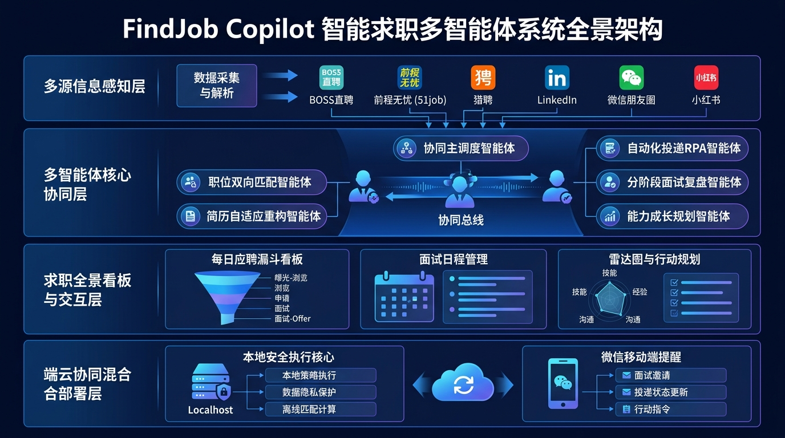
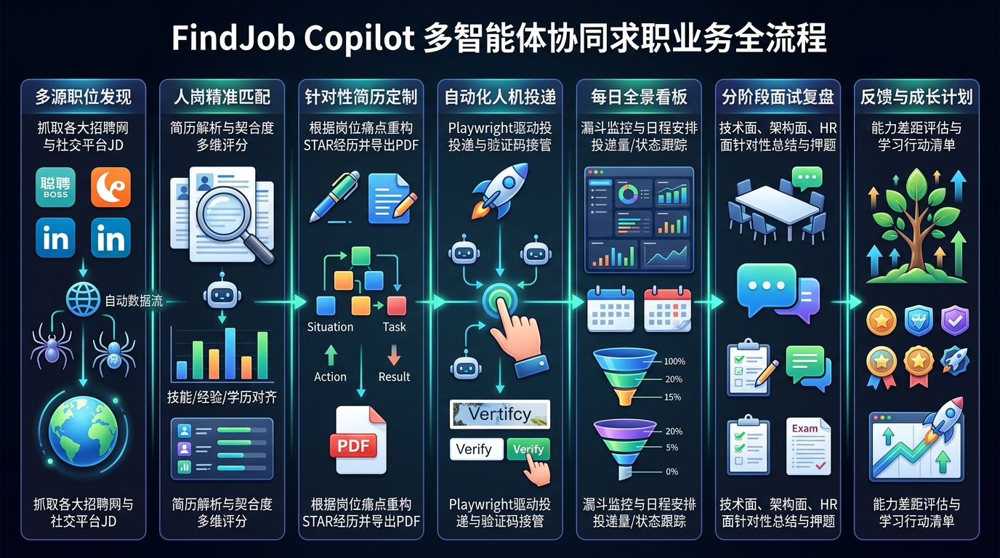
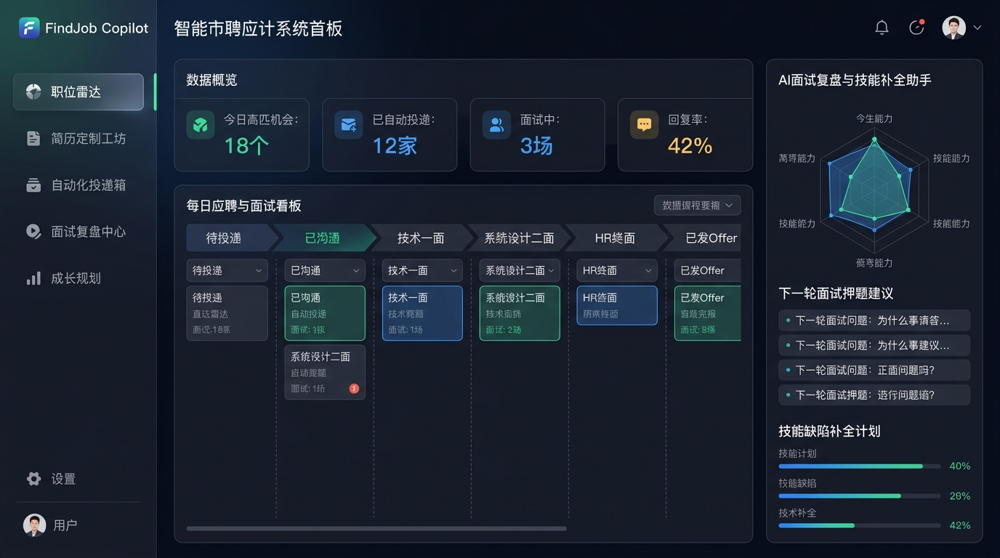

# FindJob Copilot 智能求职多智能体系统架构设计书

## 一、项目愿景与产品定位

**FindJob Copilot** 是面向个人求职者（ToC）的全流程、自适应、端到端闭环的 Agentic 智能求职副驾驶系统。

在传统求职模式中，求职者面临“职位信息多平台割裂”、“海投低反馈率”、“重复填表上传简历繁琐耗时”、“多路面试进度混乱失控”、“面试缺乏专业复盘”、“面试失败无法形成能力跃迁闭环”等核心痛点。

FindJob Copilot 采用多智能体协同（Multi-Agent System, MAS）架构，为个人求职者构建从“全网机会情报发现”到“人岗深度匹配”、“千岗千面简历动态重构”、“浏览器RPA人机协同投递”、“每日动态全景看板”，直至“分阶段面试针对性复盘”与“技能差距闭环成长”的全生命周期智能助手。

---

## 二、系统全景架构设计

系统划分为四大核心层级，实现了数据感知、智能体协同、界面交互与混合部署的清晰解耦：

### 1. 多源信息感知层 (Multi-source Perception Layer)
- **专业招聘平台**：BOSS直聘、前程无忧 (51job)、猎聘、拉勾、智联招聘等平台的职位详情、任职要求与公司画像。
- **社交与内推渠道**：LinkedIn、小红书（求职求内推帖子）、微信朋友圈（猎头/HR/前同事发布的岗位文本与海报 OCR 识别）。
- **统一数据抽象**：通过数据清洗与结构化抽取，生成标准化的职位领域模型（`JobPost`），包含硬性技术栈要求、行业经历偏好、软性素质诉求与风险预警标签。

### 2. 多智能体核心协同层 (Multi-Agent Core Orchestration Layer)
- **协同主调度智能体 (Coordinator Agent)**：基于状态机与事件总线编排各专业智能体，维护候选人的求职上下文状态。
- **职位双向匹配智能体 (Match Engine Agent)**：对候选人原始知识库（履历、技能树、求职偏好）与岗位 JD 进行双向加权语义匹配，输出 0-100 综合分、匹配亮点与短板。
- **简历自适应重构智能体 (Resume Tailor Agent)**：基于 STAR 原则针对目标岗位痛点深度重塑工作经历与项目描述，动态强化关键词匹配，导出 PDF/Word/Markdown 格式。
- **自动化投递 RPA 智能体 (Auto-Applier Agent)**：基于 Playwright 驱动本地浏览器，实现自动问候、岗位投递与针对性简历上传，内建“人机协同接管机制”，保障账号安全。
- **分阶段面试复盘智能体 (Interview Review Agent)**：针对技术一面、系统设计二面、HR/主管终面提供差异化复盘提炼与下一轮面试针对性押题辅导。
- **能力成长规划智能体 (Growth Planner Agent)**：结合面试官反馈与淘汰原因，更新技能雷达图，输出落地的技术补全学习路线与行动清单。

### 3. 求职全景看板与交互层 (Dashboard & Interaction Layer)
- **每日应聘漏斗看板**：统计今日新增高匹岗位、已沟通、已投递、HR查看、面试转化率漏斗。
- **面试日程与状态时间轴**：按公司/阶段跟踪面试流程，记录面试问题与时间节点。
- **能力雷达与技能补全看板**：可视化技能差距分析，跟踪补强任务执行进展。

### 4. 端云协同混合部署层 (Hybrid Deployment Layer)
- **本地安全执行核心 (Localhost Core)**：敏感简历数据不离本地，在本地执行浏览器自动化，避免账号被风控封禁。
- **移动轻量提醒端 (WeChat / Mobile Notification)**：通过微信服务通知、企微机器人或 PWA 推送每日精选机会与面试日程提醒。

---

## 三、业务全流程与智能体协作时序

系统覆盖端到端的七大业务阶段，各智能体分工协同紧密衔接：

### 阶段一：多源职位发现 (Job Scouting)
1. 抓取适配器启动定时扫描或用户指令触发检索。
2. 过滤已投递、已下架、黑名单公司及不匹配城市薪资的无效信息。
3. 存入本地岗位候选池（Pending Pool）。

### 阶段二：人岗精准匹配 (Intelligent Matching)
1. 匹配智能体调取用户全局简历主画像（Master Resume & Skill Tree）。
2. 执行“硬性门槛过滤（学历/年限/地点）” -> “核心技能加权相似度计算” -> “行业/业务背景契合度评估”。
3. 产出综合匹配度评分卡，高匹配度职位（>= 80分）自动流转至待投递队列。

### 阶段三：针对性简历定制 (Tailored Resume Generation)
1. 定制智能体提取目标 JD 的高频核心痛点与关键词（ATS 过滤友好）。
2. 在保持真实性的前提下，基于 STAR 原则（Situation, Task, Action, Result）优化项目描述与技术侧重点。
3. 编译生成针对该岗位的定制化专属 PDF 简历与打招呼话术。

### 阶段四：自动化人机协同投递 (Human-in-the-Loop Auto Apply)
1. 自动化智能体启动本地 Playwright 实例，加载用户本地持久化登录态（Cookies/Local Storage）。
2. 模拟真实人类操作速率与鼠标轨迹，进入岗位页面并发送定向问候语。
3. 遇到滑块验证、手机验证码或不可预期的平台风控弹窗时，智能体触发桌面通知与声音提醒，暂停操作交由用户在浏览器界面接管操作，完成后智能体无缝恢复自动化。
4. 记录投递动作，避免 30 天内重复投递同一岗位。

### 阶段五：每日全景看板 (Daily Dashboard Monitoring)
1. 每日定时汇总当日投递量、HR回复率、沟通成功率。
2. 自动拉取招聘软件上的面试邀约消息，解析面试时间、地点、形式（腾讯会议/飞书/现场），同步生成日程提醒。

### 阶段六：分阶段面试复盘 (Staged Interview Review)
1. 求职者在面试结束后输入或语音录入面试录音/记忆要点。
2. 复盘智能体根据面试轮次自动切换专业复盘评估器：
   - **技术初试**：重点复盘底层原理、算法与数据结构、技术选型推导。
   - **技术复试/系统设计**：重点复盘高并发容灾、架构权衡、业务难题落地成果。
   - **HR与主管终面**：重点复盘文化契合度、抗压能力、职业规划与薪资谈判策略。
3. 输出下一轮面试预测考题（Top 10 High Probability Questions）与专项攻坚材料。

### 阶段七：反馈评估与能力成长计划 (Feedback & Skill Growth Action Plan)
1. 录入最终面试结果（Offer、备选或未通过）。
2. 归因分析引擎提取该岗位的未满足技能点，更新个人技能雷达图。
3. 自动生成针对性的技能补全行动计划（如：补齐 K8s 生产排障实战、深入阅读某框架源码、算法专项刷题计划），帮助求职者形成“面试-复盘-补强-再战”的正向飞轮。

---

## 四、用户界面与产品原型设计 (Dashboard UI)

产品界面采用科技暗黑专业风格，聚焦于高效求职过程跟踪与能力成长：

### 界面核心功能区域：
1. **左侧导航栏**：
   - 职位雷达（全网机会浏览与抓取过滤）
   - 简历定制工坊（职位针对性重塑与多版本管理）
   - 自动化投递箱（投递队列、投递日志与自动化配置）
   - 面试复盘中心（录音解析、复盘问答库与押题辅导）
   - 成长规划（技能雷达图与自我提升行动任务清单）
2. **顶部数据概览 (KPI Cards)**：
   - 今日高匹机会数量
   - 已自动投递企业数
   - 正在推进中的面试场次
   - 整体沟通回复率
3. **主体看板泳道 (Job Application Pipeline)**：
   - 待投递 -> 已沟通 -> 技术一面 -> 系统设计二面 -> HR终面 -> 已发 Offer
   - 支持拖拽流转、点击查看岗位详情、一键查看定制简历、快捷录入面试记录。
4. **右侧 AI 助手面板 (AI Copilot Panel)**：
   - 个人能力雷达图（深度展现专业技术、架构经验、业务理解、沟通表达等多维评分）
   - 下一轮面试押题与准备建议卡片
   - 技能缺陷补全计划进度跟踪条

---

## 五、部署形态权衡分析与架构决议 (ADR)

### 1. 方案对比矩阵

| 评估维度 | 方案 A：纯本地个人应用 (Localhost / 桌面端) | 方案 B：纯云端微信小程序 (SaaS) | 方案 C：端云协同混合架构（推荐） |
| :--- | :--- | :--- | :--- |
| **数据隐私与合规** | 极优：所有隐私数据、个人信息、Cookie 均存放在本机 SQLite | 较差：敏感简历、平台账密集中在云端，面临巨大的合规审查与数据泄露风险 | **极优**：核心敏感数据与账号完全本地化，云端仅作加密传输与消息桥接 |
| **平台反爬与风控对抗** | 极优：使用本机 Chrome 浏览器，真实本地 IP 与硬件指纹，安全稳定 | 极差/不可行：各大平台（BOSS直聘等）对云端数据中心 IP 具有极强封禁规则，批量投递必然被封号 | **极优**：爬取与投递均在本地执行，完全复刻真人用户日常操作行为 |
| **移动端实时触达** | 较弱：离开电脑无法查看实时通知 | 极优：随时随地查看微信推送、面试提醒与消息通知 | **极优**：电脑本地静默执行，微信/企微/移动端秒级接收关键通知与日报 |
| **算力与运行成本** | 极低：无需高昂云服务器，个人调用大模型 API 或本地 Ollama | 较高：需要维护大规模云端集群、无头浏览器集群、代理 IP 池 | **极低**：单机极简运行，支持自选大模型（OpenAI/Claude/DeepSeek/本地模型） |

### 2. 最终部署落地建议
- **核心推荐形态**：**Localhost 桌面/本地服务 + 移动轻量通知通道 (Hybrid Architecture)**
  - 核心计算与自动化执行引擎运行在用户的个人电脑上（支持 Windows / macOS / Linux），以 Docker 或一键脚本（`python -m src.main`）启动本地 WebUI（`http://localhost:8000`）。
  - 支持快捷配置本地已登录浏览器的 User Data 目录，实现免密安全的自动化投递。
  - 移动端通过轻量微信模板消息、企业微信机器人或自建 Webhook 接收每日高匹配职位推荐清单与面试日程提醒。
